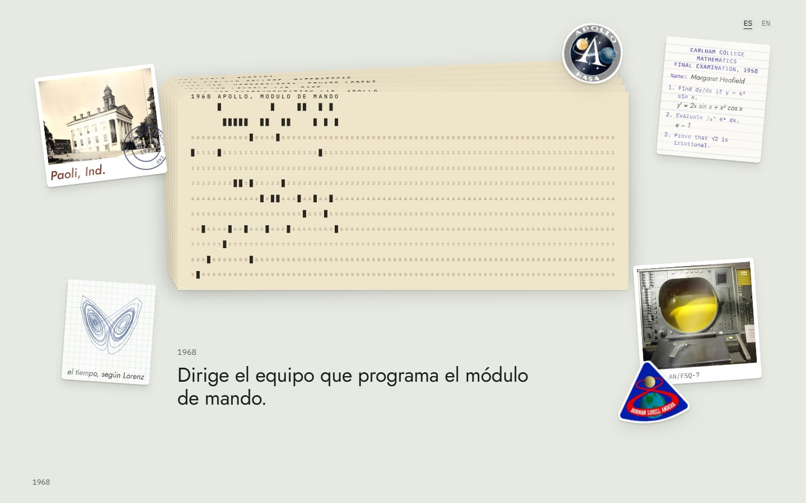
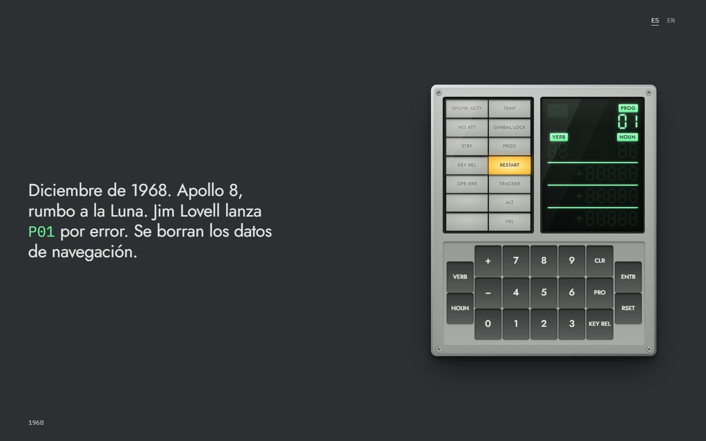
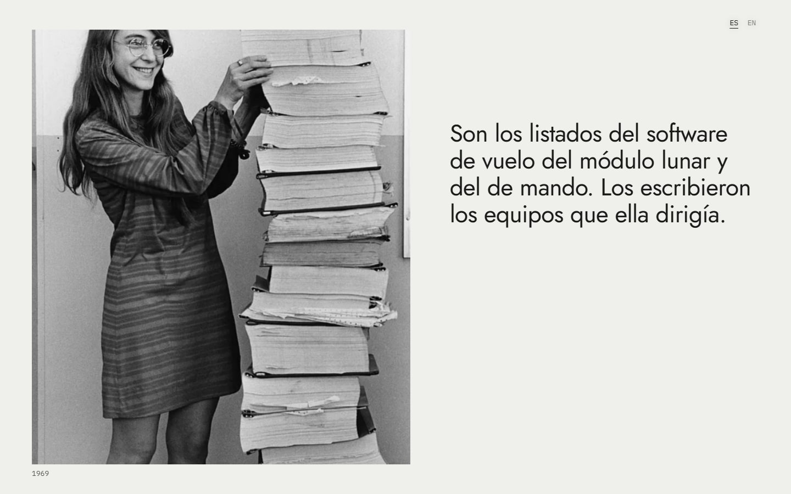
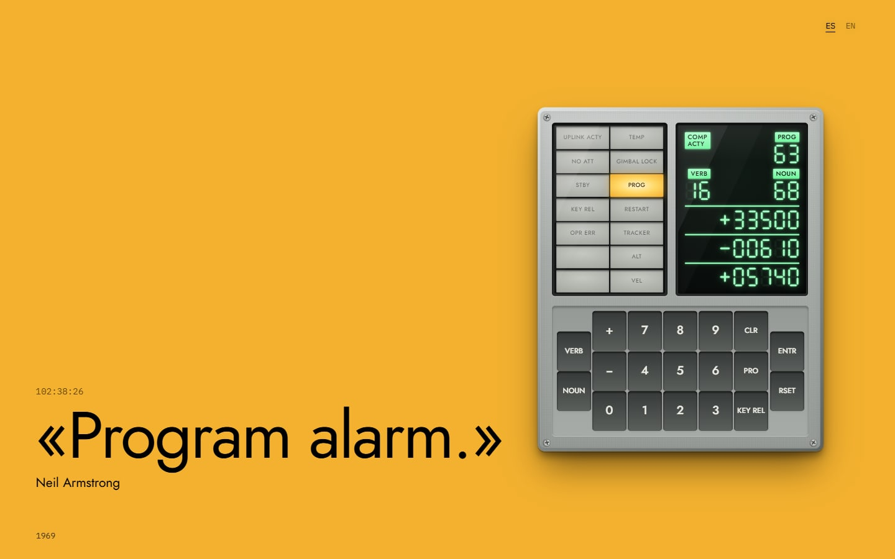
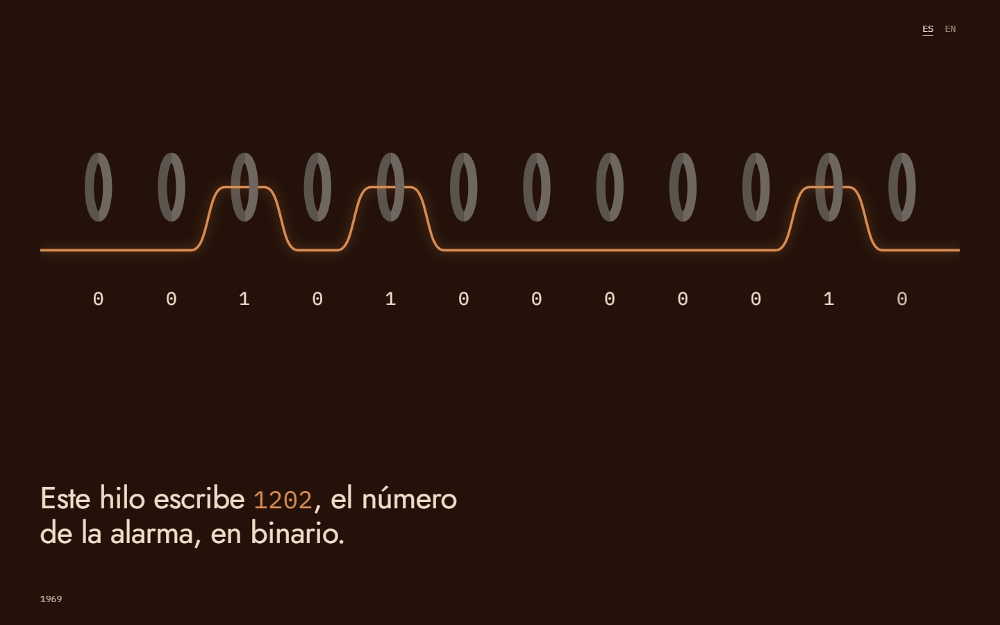
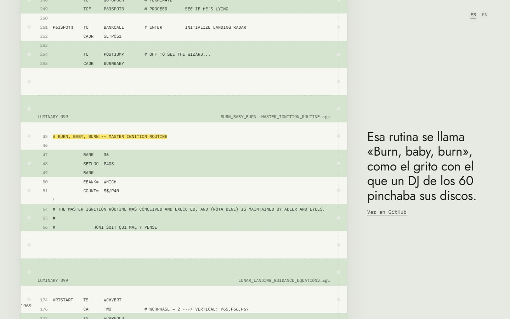
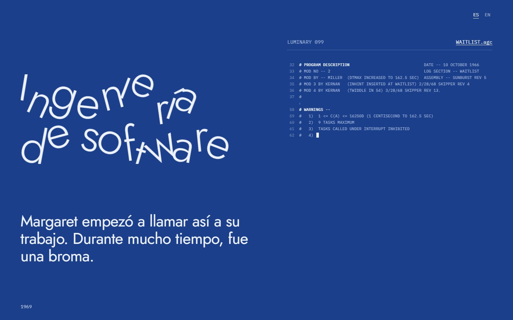
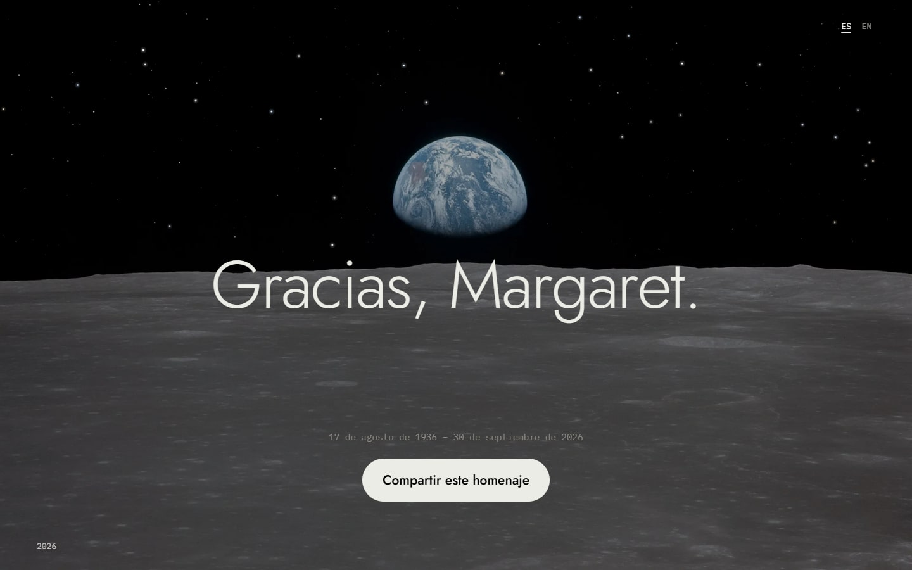

<div align="center">

# margarethamilton.dev

**Un homenaje a Margaret Hamilton (1936–2026) que cobra vida al desplazarte por la página**, la mujer que lideró el desarrollo del software de vuelo del Apolo 11 y dio nombre a la ingeniería de software.

[**Visita el sitio →**](https://margarethamilton.dev/) · [Español](https://margarethamilton.dev/) · [English](https://margarethamilton.dev/en/)

Documentación disponible en: 🌐 [English](README.md) | 🇪🇸 [Español](README.es.md)


</div>

## Acerca del proyecto

> “There was no choice but to be pioneers. No time to be beginners.”
> — Margaret Hamilton

Este sitio cuenta su historia en un recorrido continuo, desde Paoli, Indiana, en 1936 hasta la Medalla Presidencial de la Libertad en 2016. Cada capítulo es una escena a pantalla completa animada al desplazarte en el sitio: tarjetas perforadas, un DSKY funcional, la torre de listados impresos, la alarma 1202, la memoria de núcleos cableados tejida a mano y el código fuente real del Apolo 11.

## Escenas


| # | Escena | Qué sucede |
| :-- | :-- | :-- |
| 1 | **Apertura** | Las estrellas sobre el amanecer de la Tierra se colocan en su sitio y se convierten en las letras de su cita. |
| 2 | **Hitos** | Sus primeros años (Earlham, Edward Lorenz, SAGE, Apolo) perforados con código Hollerith real en tarjetas perforadas de 80 columnas, como las que se usaban en el MIT. |
| 3 | **Lauren** | Un DSKY funcional recrea la historia de su hija bloqueando el simulador con P01, el error que Jim Lovell repitió en el Apolo 8 y el nacimiento de la programación defensiva. |
| 4 | **La torre** | La famosa foto de 1969 junto a los listados, apilados carpeta a carpeta con los nombres reales de los módulos de Luminary 099 y Comanche 055. |
| 5 | **La alarma 1202** | El descenso del Apolo 11: las alarmas de programa en el DSKY, “We’re Go on that alarm” and “The Eagle has landed.” |
| 6 | **Memoria de núcleos cableados** | Un hilo atraviesa núcleos magnéticos para escribir `1202` en binario: software que se tejía literalmente a mano. |
| 7 | **El código** | Fragmentos reales de Luminary 099 (`BURN_BABY_BURN`, `PINBALL_GAME_BUTTONS_AND_LIGHTS`, "PLEASE CRANK THE SILLY THING AROUND") enlazados a sus líneas exactas en GitHub, que terminan con su firma en el README. |
| 8 | **Ingeniería de software** | Las dos palabras se tambalean como la broma que fueron en su día, luego se enderezan y ganan peso al desplazarte, hasta dar nombre a una profesión. |
| 9 | **Legado** | Higher Order Software, Hamilton Technologies, el Premio al Acto Espacial Excepcional de la NASA y la Medalla Presidencial de la Libertad. |
| 10 | **Cierre** | "Gracias, Margaret". |

## Capturas de pantalla

<table>
  <tr>
    <td width="50%"></td>
    <td width="50%"></td>
  </tr>
  <tr>
    <td align="center"><sub>Hitos en tarjetas perforadas de 80 columnas</sub></td>
    <td align="center"><sub>Un DSKY funcional y el incidente P01</sub></td>
  </tr>
  <tr>
    <td></td>
    <td></td>
  </tr>
  <tr>
    <td align="center"><sub>MIT, 1969: la torre de listados</sub></td>
    <td align="center"><sub>"Alarma de programa".</sub></td>
  </tr>
  <tr>
    <td></td>
    <td></td>
  </tr>
  <tr>
    <td align="center"><sub>Memoria de núcleos cableados que escribe <code>1202</code></sub></td>
    <td align="center"><sub>El código fuente real del Apolo 11</sub></td>
  </tr>
  <tr>
    <td></td>
    <td></td>
  </tr>
  <tr>
    <td align="center"><sub>"Ingeniería de software", antes una broma</sub></td>
    <td align="center"><sub>Gracias, Margaret.</sub></td>
  </tr>
</table>

## Cómo funciona

- **[Astro](https://astro.build) sin frameworks de UI.** El sitio es completamente estático: componentes de Astro, CSS local y unos pocos módulos pequeños de TypeScript.
- **Escenas animadas al desplazarte.** Cada `[data-scene]` es un contenedor alto con un escenario fijo mediante `sticky`. [`src/scripts/scroll.ts`](src/scripts/scroll.ts) calcula su progreso (0 → 1) y lo expone como la propiedad personalizada `--p`, de modo que la mayoría de las animaciones son CSS puro. Los textos aparecen en su momento mediante `data-beat`, y el tema de la página y el indicador del año siguen la escena activa.
- **Estrellas que se convierten en letras.** [`src/scripts/stars.ts`](src/scripts/stars.ts) distribuye estrellas candidatas por el cielo de la foto y empareja cada glifo con una estrella mediante una asignación óptima, para que las trayectorias nunca se crucen.
- **Un DSKY en HTML y CSS.** [`Dsky.astro`](src/components/Dsky.astro) y [`src/scripts/dsky.ts`](src/scripts/dsky.ts) recrean la pantalla y el teclado del ordenador de guiado del Apolo, con dígitos electroluminiscentes segmentados.
- **El código fuente real.** [`src/data/listing.ts`](src/data/listing.ts) contiene fragmentos literales de Luminary 099, el software del módulo lunar, con sus números de línea originales. El número de estrellas de [chrislgarry/Apollo-11](https://github.com/chrislgarry/Apollo-11) en GitHub se obtiene durante la compilación.
- **Bilingüe.** Español (predeterminado, `/`) e inglés (`/en/`) con el enrutamiento i18n de Astro y una pequeña función auxiliar `t({ es, en })`. La primera visita sigue el idioma del navegador y la elección se recuerda.
- **Tipografía con historia.** [Jost](https://fonts.google.com/specimen/Jost), una reinterpretación de Futura, la tipografía de la placa que el Apolo 11 dejó en la Luna, combinada con IBM Plex Mono. Ambas se alojan en el propio sitio mediante la API de fuentes de Astro.
- **Detalles.** Imágenes adaptables optimizadas con `astro:assets`, compatibilidad con `prefers-reduced-motion`, textos alternativos descriptivos, imagen Open Graph, JSON-LD, enlaces alternativos `hreflang` y un mapa del sitio.

## Estructura del proyecto

```text
/
├── public/                 # favicon, Open Graph image, robots.txt, sitemap.xml
└── src/
    ├── assets/             # photos and stickers, optimized at build time
    ├── components/
    │   ├── scenes/         # one component per chapter of the story
    │   ├── Dsky.astro      # Apollo Guidance Computer display and keyboard
    │   ├── Home.astro      # composes all the scenes
    │   ├── StarText.astro  # text whose letters are born from stars
    │   └── Starfield.astro
    ├── data/listing.ts     # real fragments of the Luminary 099 source code
    ├── layouts/Layout.astro
    ├── pages/              # / (Spanish) and /en/ (English)
    ├── scripts/            # scroll engine, starfield and DSKY logic
    └── i18n.ts
```

## Primeros pasos

Requisitos: Node.js `>=22.12.0` y [pnpm](https://pnpm.io).

```sh
git clone https://github.com/midudev/margarethamilton.dev.git
cd margarethamilton.dev
pnpm install
pnpm dev
```

| Comando | Acción |
| :-- | :-- |
| `pnpm dev` | Iniciar el servidor de desarrollo en `localhost:4321` |
| `pnpm build` | Compilar el sitio de producción en `./dist/` |
| `pnpm preview` | Previsualizar la compilación de producción en local |

## Créditos

- **Fotos.** NASA (Apolo 11, simulador del módulo de mando, retrato de 1989). Draper Laboratory, 1969, restaurada por Adam Cuerden. La Casa Blanca, 2016. Memoria de núcleos cableados: Wikimedia Commons. Todas de dominio público. Figura de LEGO: [Maia Weinstock](https://www.flickr.com/photos/pixbymaia/27769398384/), [CC BY-NC-ND 2.0](https://creativecommons.org/licenses/by-nc-nd/2.0/). Retrato de 1995: [Daphne Weld Nichols](https://commons.wikimedia.org/wiki/File:Margaret_Hamilton_1995.jpg), [CC BY-SA 3.0](https://creativecommons.org/licenses/by-sa/3.0/), convertido a blanco y negro.
- **Código.** Luminary 099, transcrito por el proyecto [Virtual AGC](https://www.ibiblio.org/apollo/) a partir de los listados del Museo del MIT, en [github.com/chrislgarry/Apollo-11](https://github.com/chrislgarry/Apollo-11).
- **Fuentes.** [MIT News](https://news.mit.edu/2026/margaret-hamilton-computing-pioneer-dies-1007) y el [Apollo Lunar Surface Journal](https://apollojournals.org/alsj/a11/a11.landing.html).

## Licencia

El código fuente se publica bajo la [licencia MIT](LICENSE). Las fotos y otros contenidos multimedia de terceros conservan sus licencias originales, indicadas en [Créditos](#créditos), y no están cubiertos por ella.

<div align="center">
  <br />
  <sub>Gracias, Margaret.</sub>
</div>
